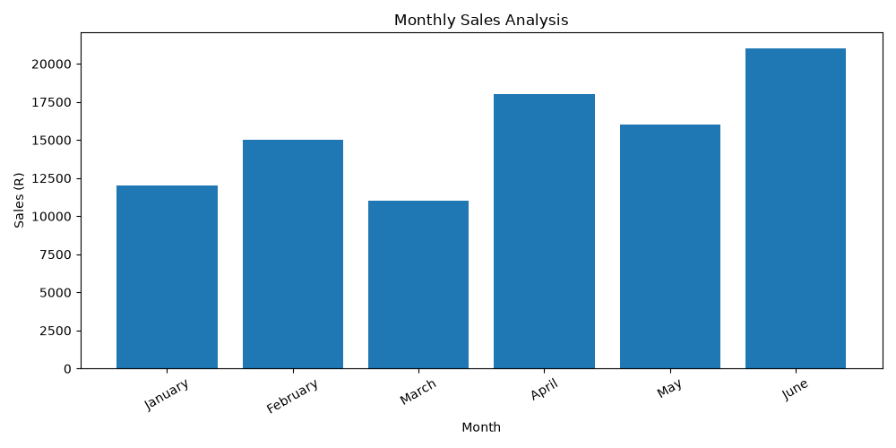
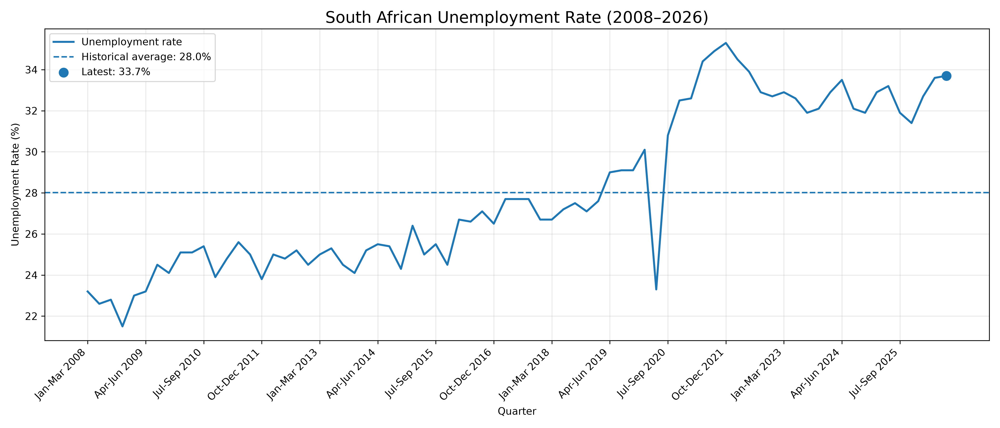
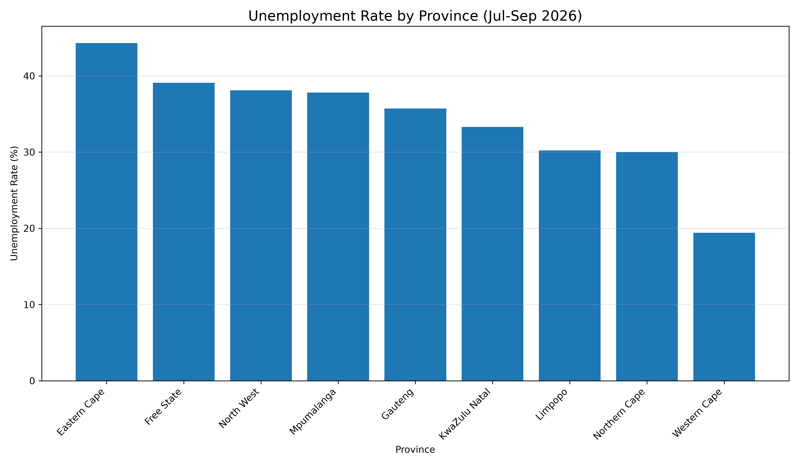
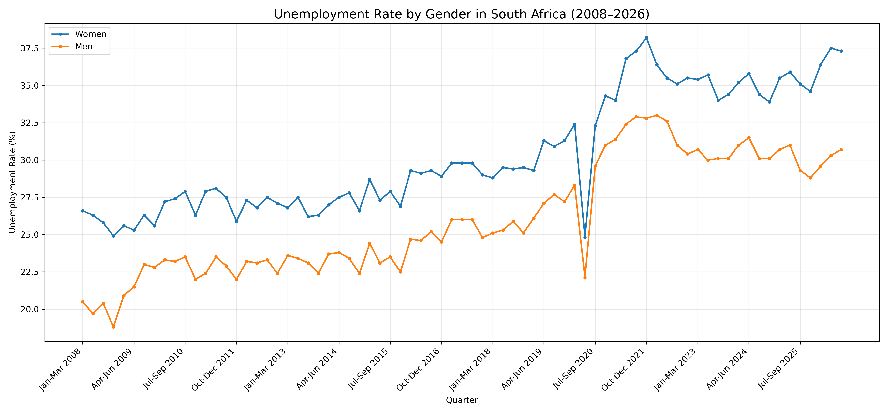

# South African Data Analysis 🇿🇦

## Project Overview

This project demonstrates my development in Python programming, data analysis, statistical interpretation and data visualisation.

It contains practical exercises using Python to analyse datasets, identify trends and communicate findings through visualisations.

The project currently includes a fictional monthly sales analysis and an investigation of South African unemployment trends using Quarterly Labour Force Survey (QLFS) data from Statistics South Africa (Stats SA).

## Tools and Technologies

- Python
- Pandas
- Matplotlib
- Excel
- Git and GitHub
- Visual Studio Code

## Projects and Analysis

### 1. Monthly Sales Analysis

A beginner Python exercise using fictional monthly sales data.

The analysis:
- Creates a structured dataset.
- Calculates average, maximum and minimum sales.
- Generates a monthly sales bar chart.

### 2. South African Unemployment Analysis

An investigation of unemployment trends using Stats SA Quarterly Labour Force Survey data.

The analysis includes:

**National unemployment trends**
- Examines unemployment rates over time.
- Calculates descriptive statistics.
- Identifies long-term changes in unemployment.

**Provincial unemployment comparison**
- Compares unemployment rates across all nine provinces.
- Identifies provinces with the highest and lowest unemployment rates.

**Gender unemployment comparison**
- Compares unemployment rates between women and men.
- Examines the difference between the two groups over time.

## Key Findings

Based on the dataset currently analysed (July–September 2026):

- National unemployment rate: 33.7%.
- Highest provincial unemployment rate: Eastern Cape (44.3%).
- Lowest provincial unemployment rate: Western Cape (19.4%).
- Women's unemployment rate: 37.3%.
- Men's unemployment rate: 30.7%.
- Gender unemployment gap: 6.6 percentage points.

These findings are descriptive and do not establish the causes of unemployment.

## Visualisations

### 1. Monthly Sales Analysis


### 2. South African Unemployment Trend


### 3. Provincial Unemployment Comparison


### 4. Gender Unemployment Comparison


## Data Source

Statistics South Africa (Stats SA) – Quarterly Labour Force Survey (QLFS).

The unemployment analysis uses the QLFS trends Excel workbook covering 2008 to the third quarter of 2026.

The dataset is not included in this repository. Users should obtain the relevant workbook from Stats SA and place it in the `data/` directory before running the analysis scripts.

## Project Structure

```text
south-african-data-analysis/
│
├── data/
│   └── (QLFS Excel dataset - not included)
│
├── images/
│   ├── monthly_sales.png
│   ├── sa_unemployment_trend.png
│   ├── provincial_unemployment.png
│   └── gender_unemployment.png
│
├── src/
│   ├── first_analysis.py
│   ├── unemployment_analysis.py
│   ├── provincial_analysis.py
│   └── gender_analysis.py
│
├── .gitignore
└── README.md
```

## Running the Project

1. Clone this repository.
2. Install the required libraries:

```bash
pip install pandas matplotlib openpyxl
```

3. Place the QLFS Excel workbook in the `data/` directory.
4. Run an analysis script:

```bash
python src/unemployment_analysis.py
python src/provincial_analysis.py
python src/gender_analysis.py
```

## Important Note

The monthly sales dataset is fictional and is used for learning purposes.

The unemployment findings are based on the Stats SA dataset used in this project. Results may change when newer data become available.

## Author

Bhekimuzi Makhubele

GitHub: https://github.com/Muzi67